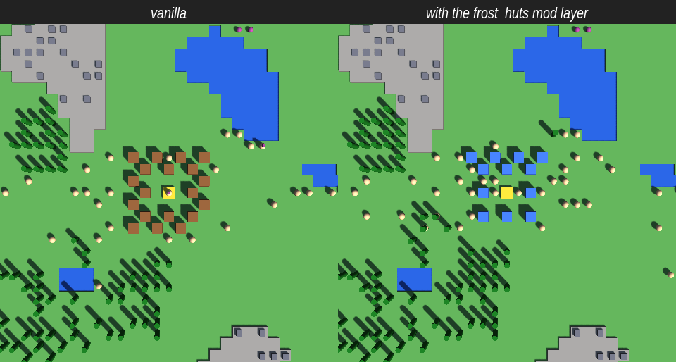
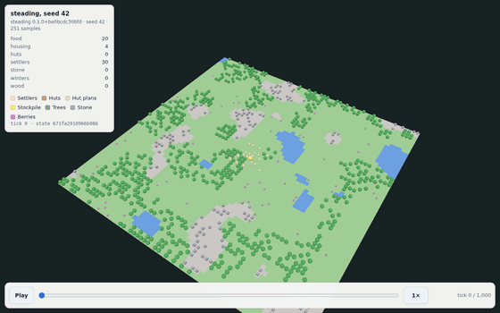

# steading

A small colony/settlement sim where **OpenUSD is the world, save and mod format** and the simulation runs on flat
arrays. It is built on **Strata**, a shared C++ engine.


*1,000 ticks of seed 42 (five winters), rendered headless by the real game:
`steading --new 42 --headless --ticks 1000 --frames out/ --frame-every 8 --width 480 --height 480 --zoom 2.6`.*

Status: early development (RFC 0019 milestone M2, "colony v0"). The colony plays, saves and reloads through Strata's
save core, and two demo mods stack in load order.

## Design in one paragraph

A seed generates a **base layer**. Prefabs (settler, hut, tree, …) live in a content library that entities
reference. **Mods are USD sublayers** stacked in an explicit load order, **saves are thin delta sublayers** over
base + mods, and seasons are **variants**. The simulation never touches USD per tick: it ticks plain arrays and meets
USD only when loading, saving and recording history. Save safety comes first: a save is checksummed before USD ever
parses it, a damaged or missing layer is refused rather than silently skipped, and the previous save is always kept.

## Playing

A settlement of settlers gathers wood, stone and berries, builds huts and grows. Seasons alternate every 100 ticks;
in winter trees stop regrowing. Settlers starve without food. **Win** by surviving 5 winters or reaching 60
settlers; **lose** when nobody is left.

| Input | Action |
|---|---|
| Space | pause / resume |
| `+` / `-` | speed |
| left-drag | designate tiles for gathering (settlers prefer them); Ctrl+drag clears |
| right-click | plan a hut there (built first when wood allows), or cancel a plan |
| F5 / F9 | save now / reload the last save |
| Esc | quit (saves first) |

The game autosaves every 500 ticks off the main thread. Saves live in a slot directory (`--slot DIR`, default
`saves/default`).

```sh
steading --new 42                       # a new colony from seed 42
steading                                # continue the last save
steading --mods frost_huts,cheap_huts   # mods in load order (later wins)
steading --headless --ticks 400 --screenshot out.png
steading --headless --ticks 1000 --frames out/ --frame-every 8 --zoom 2.6   # timelapse frames
```

## Building

The rules, generation and mod manifests need only a C++17 compiler and CMake:

```sh
cmake -S . -B build && cmake --build build && ctest --test-dir build
```

The playable game is built on [Strata](https://github.com/Preponderous-Software/strata) and needs an OpenUSD
install (Strata publishes a prebuilt one for Linux; see Strata's `modules/usd/README.md`):

```sh
cmake -S . -B build -DSTEADING_WITH_STRATA=ON -DSTEADING_STRATA_REF=$(cat strata.ref) \
  -DCMAKE_PREFIX_PATH=/path/to/openusd
cmake --build build && ctest --test-dir build
```

## Mods

A mod is a directory under `mods/` with a `mod.toml` and one or more USD layers. Mods are data only: they override
prefab stats and looks (see `mods/cheap_huts` and `mods/frost_huts`).



The same seed at tick 400, without and with `--mods frost_huts`: one USD layer repaints the huts and raises their
capacity, so the colony also builds fewer of them. The save records the load order, and loading
with a different set or order is refused unless `--force-mods` is given.

## History replays

A colony's history can be shared as a **replay** in usd-recorder's
[`usd-replay/1`](https://github.com/Preponderous-Software/usd-recorder/blob/v0.2.0/docs/REPLAY.md) contract: one USD
file any player of that contract can show, here in [usd-web](https://github.com/Preponderous-Software/usd-web)'s
browser player.



*Seed 42, 1,000 ticks, a sample every 4 ticks: a 0.9 MB `.usdc`, a 55 KB web replay. The panel shows the colony's
counters and its state fingerprint at each sample.*

```sh
steading-replay --new 42 --ticks 1000 --every 4 --out run.usda    # from a seed (no save involved)
steading-replay --slot saves/default --ticks 500 --out run.usda   # from a save (Strata build), read-only
usd-recorder replay validate run.usda && usd-recorder replay convert run.usda run.usdc
usd-web replay run.usdc -o site/replay                             # then serve usd-web's viewer/replay.html
```

Settlers, huts, hut plans, the stockpile, trees (sized by what is left on them, white in winter), stone and berries
are point sets; the terrain (with winter and designated tiles) is a colour grid; wood, stone, food, settlers,
housing and winters are stats. Each sample's state hash is the colony's own `fingerprint()`, so the replay of seed
42 ends on the same `011ed2b2f364b21b` that `tests/test_determinism.cpp` pins, and `tests/test_replay.cpp` checks
that recording does not change a single fingerprint.

**Saves are only read, never written:** `--slot` copies the slot's save files to a temporary directory and loads
the copy through the save core (so not even the slot's lock is taken), runs the colony forward with the rules, and
saves nothing. CI checks the slot's files are byte-identical afterwards and that the history from a save matches a
fresh run of the same seed tick for tick. The writer is usd-recorder's dependency-free header, vendored in
`third_party/usd_recorder/`, so the replay needs no OpenUSD; the save format is unchanged.

## License

MIT, see [LICENSE](LICENSE).
